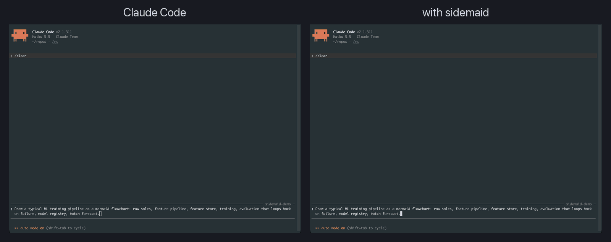

# sidemaid

[](https://github.com/nejox/sidemaid/actions/workflows/ci.yml)

*Sidebar + mermaid.* A Claude Code mod that renders the Mermaid diagrams Claude writes as real images in a side pane of your terminal. The diagram stays in view while you keep talking about it.



## How it works

1. You ask for a diagram ("show the data flow as a diagram"). Claude answers with an ordinary ` ```mermaid ` block. There is no extra tool and no permission prompt.
2. The mod takes every mermaid block from Claude's replies, renders it in the background with [mermaid-cli](https://github.com/mermaid-js/mermaid-cli) (`mmdc`), and shows the newest one in the pane. The pane opens on its own when the terminal docks panes.
3. In the transcript, the block is drawn as a one-line pointer to the pane. Claude's context and the saved conversation keep the full source.
4. Ask for changes and the new version becomes the next entry. Page back to compare.

The mod also attaches a short note to your first prompt, and to any prompt that asks for a diagram (under 100 tokens): diagrams show in a pane, so Claude writes a mermaid block rather than an artifact or HTML page, lays it out top-down, stays under about 25 nodes, and sets a title with `%% title: …`. The note rides on the prompt rather than the system prompt, because an organization's policy plugin may skip a user plugin's system-prompt hook. You can turn it off.

## Requirements

- Claude Code 2.1.311 or later.
- A terminal that shows images: kitty, Ghostty, or iTerm2 3.5+ with fullscreen rendering (`"tui": "fullscreen"` in `~/.claude/settings.json`). Inside tmux, `allow-passthrough` and `focus-events` must be on. In other terminals the pane shows the diagram's source.
- mermaid-cli:

  ```sh
  npm i -g @mermaid-js/mermaid-cli
  ```

  mermaid-cli renders in a headless Chrome. If Chrome or Chromium is installed in a usual place, the mod uses it, so you can skip puppeteer's own browser download:

  ```sh
  PUPPETEER_SKIP_DOWNLOAD=true npm i -g @mermaid-js/mermaid-cli
  ```

### Tested on

| Platform | Status |
| --- | --- |
| macOS, iTerm2 3.7, Claude Code 2.1.311 | Tested in live sessions: capture, render, pane, images, paging, copy, open, save |
| kitty, Ghostty (macOS or Linux) | Untested; the mod API draws images there |
| Linux in general | Untested; `o` uses `xdg-open` |
| Windows | Not supported yet: opening and saving use macOS and Linux commands |
| Desktop app, VS Code, mobile | The pane shows the diagram's source, not the image |

## Install

At the prompt of a Claude Code session in a terminal:

```
/plugin install sidemaid --marketplace nejox/sidemaid
```

Answer `y` to add the marketplace, then pick a scope (user installs it for every session).

From a shell:

```sh
claude plugin install sidemaid --marketplace nejox/sidemaid
```

In the desktop app, where `/plugin` does not run: click + next to the prompt box, then Plugins, Add marketplace with `nejox/sidemaid`, then Add plugin.

## Use

| Where | What |
| --- | --- |
| `/mermaid` | Open the pane and give it the keyboard |
| `/mermaid clear` | Empty the diagram list |
| `p` / `n` | Previous / next diagram (pane focused) |
| `c` | Copy the mermaid source |
| `o` | Open the PNG in your image viewer, to zoom and pan with trackpad or mouse (`open` on macOS, `xdg-open` on Linux) |
| `s` | Save `<title>.mmd` and `<title>.png` to `docs/diagrams/` in the working directory |
| `esc` | Back to the prompt |

The pane's buttons can be clicked with the mouse too.

The pane keeps the last 30 diagrams of the session. A render takes about 2 seconds (4 for the first one, while Chrome starts). Renders are cached in `~/.cache/sidemaid/` by theme and source.

## Configuration

None is needed: every option has a default. The installer's note that options are not yet set can be ignored. To change one, use `/config`, or `pluginConfigs` in `~/.claude/settings.json`:

| Option | Default | Meaning |
| --- | --- | --- |
| `theme` | `dark` | Mermaid theme: `dark`, `default`, `neutral`, `forest` |
| `autoOpen` | `true` | Open the pane when a new diagram arrives |
| `collapseInTranscript` | `true` | Draw a one-line pointer in place of each mermaid block |
| `promptHint` | `true` | Tell Claude about the pane (top-down layouts, titles) |
| `saveDir` | `docs/diagrams` | Where `s` saves, relative to the working directory |
| `mmdcPath` | `mmdc` | The mermaid-cli executable |
| `chromePath` | empty | The browser mmdc uses; empty uses an installed Chrome or Chromium, else puppeteer's own |

## Limits

- Only blocks from the main conversation are captured, not from subagents.
- While a reply streams, its mermaid block shows as code until the block is complete.
- The terminal's width decides where the pane goes. From 144 columns it opens by itself beside the transcript. From 110 it docks there when you run `/mermaid`. Below 110 it opens above the prompt with a third of the screen's height, which makes tall diagrams small; a toast says when a diagram is ready.
- The pane shows the whole diagram, at most at its rendered size. There is no zoom inside the pane, because iTerm2 draws a picture whole or not at all: `o` opens it where you can zoom.
- The desktop app, VS Code and mobile show the source in the pane, not the image.

## Development

```sh
claude plugin validate .
claude plugin test .
claude --plugin-dir .
```

Two project skills check the mod in real sessions on macOS with iTerm2:

- `.claude/skills/live-check/`: runs the mod at a given terminal size and keeps snapshots (screen text through tmux, or screenshots of an iTerm2 window).
- `.claude/skills/demo-gif/`: records `docs/demo.gif` from `storyboard.yml`, without and with sidemaid side by side.

## Credits

The fence regex is adapted from [ccmermaid](https://github.com/weichieh0204/ccmermaid) (MIT).

## License

MIT
